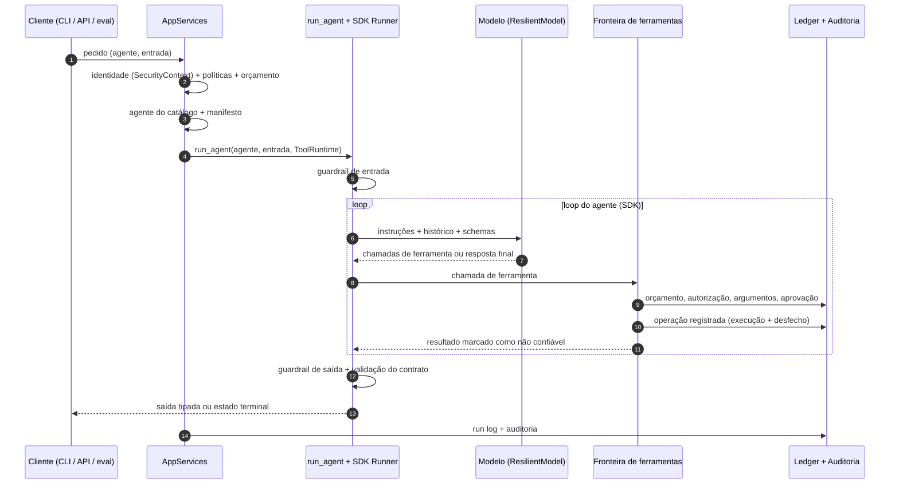
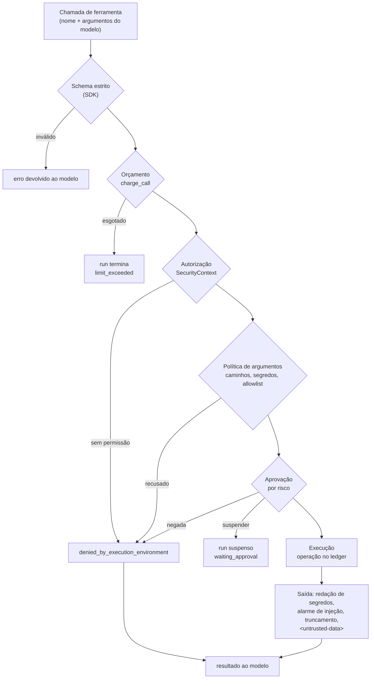
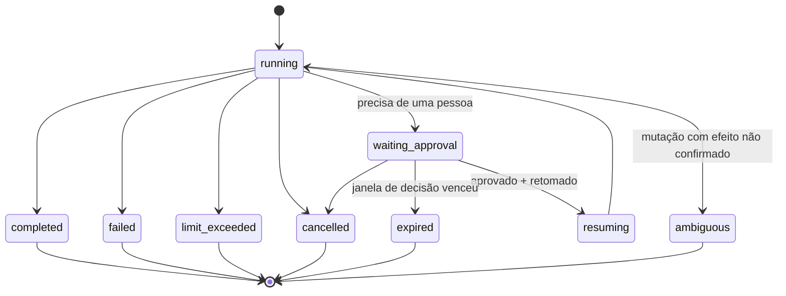

# Ciclo de vida de uma execução

Uma **execução** (*run*) é uma execução identificada de um agente ou workflow: tem `run_id`,
identidade, orçamento e manifesto próprios. Esta página segue um run do pedido ao estado terminal.

## Visão geral

## Etapas

### 1. Solicitação

Um run começa por um ponto de entrada confiável:

| Entrada | Exemplo |
|---|---|
| CLI | `agent-app run "..." --agent <id>` (opcionalmente `--durable`) |
| API | `POST /api/v1/runs` com `{"kind": "agent", "agent": "<id>", "input": "..."}` |
| Workflow | `agent-app workflow incident INC-1042`, em que cada nó de agente é uma chamada a `run_agent` |
| Avaliação | um caso de dataset com `"agent": "<id>"` |
| Código | `await services.run_agent("<id>", prompt, runtime)` |

### 2. Identificação do principal

A identidade do run vem **só** do ponto de entrada, nunca do modelo:

| Origem | Principal | Confiança |
|---|---|---|
| CLI | `local_developer`, a partir de `IDENTITY_*` | afirmada por configuração, não autenticada |
| API | `authenticated_user` ou `service`, a partir de uma chave de API verificada | autenticada |
| Avaliações, CI, workers | `service` | identidade do próprio processo |

O resultado é um `SecurityContext` imutável (tenant, principal, identidade do agente, permissões,
`run_id`), que acompanha o run inteiro.

### 3. Resolução do agente

O id é resolvido no `AgentCatalog`. Um id desconhecido é recusado antes de qualquer execução. O
`CatalogAgent` fornece a função que monta o `Agent` do SDK com as ferramentas permitidas e o contrato
de saída.

### 4. Carregamento de políticas

Todas definidas por código confiável e configuração do servidor:

- **Aprovação** (`ApprovalPolicy`): modo por nível de risco. O padrão libera `read_only`, exige uma
  pessoa para mutações e nega `destructive`, mesmo com aprovação.
- **Orçamento** (`ExecutionBudget`): `BUDGET_*` ou valores passados pelo código.
- **Workspace**: raiz, escrita habilitada ou não, limites de tamanho, padrões sensíveis.
- **Comandos**: allowlist de aliases, timeout, executor (`local` ou `docker`).
- **Resiliência do modelo**: tentativas, backoff, timeout por tentativa, fallbacks.
- **Rede** (se as ferramentas web estiverem habilitadas): política de domínios e limites.

### 5. Construção do runtime

`AppServices.tool_runtime(...)` monta o `ToolRuntime`: identidade, workspace, executor, *ledger* de
orçamento, porta de aprovação, *ledger* de operações, token de cancelamento e destino de eventos.
Antes da primeira chamada ao modelo é construído o **`ExecutionManifest`**, anexado uma única vez e
nunca reescrito.

### 6. Execução do modelo

O `Runner` do SDK executa o loop do agente. O guardrail de entrada roda antes da primeira chamada.
Cada chamada passa pelo `ResilientModel` (retry e fallback sob o mesmo orçamento) e pelo limite de
turnos restante. Tokens e custo são verificados depois de cada resposta: a chamada que cruza o
limite já foi paga, mas as ferramentas que ela pediu não executam.

### 7. Invocação de ferramentas

Uma recusa **não** derruba o run: o modelo recebe
`{"error": "denied_by_execution_environment", "reason": ...}` e decide o que fazer. Uma ferramenta
**nunca** é repetida automaticamente pela aplicação. Se o modelo pedir de novo, o novo pedido passa
por toda a política outra vez.

### 8. Autorização e orçamento

A ordem em toda fronteira é fixa: **orçamento → autorização → argumentos → aprovação → efeito**. A
autorização vale também para ferramentas somente leitura. A aprovação não substitui a permissão: a
porta de aprovação reverifica a permissão antes de perguntar a alguém.

| Limite | Quando é verificado | Garantia |
|---|---|---|
| Turnos | antes de cada chamada ao modelo | exata |
| Chamadas de ferramenta (locais + MCP) | antes da autorização | exata: a excedente não executa |
| Tokens e custo estimado | antes (já esgotado) e depois de cada resposta | observada: ultrapassagem de até uma chamada |
| Duração do run | antes de cada passo e por timeout | interrompe o que está em voo |
| Timeout por ferramenta | durante a ferramenta | a ferramenta falha (`timeout`), o run continua |

### 9. Registro de operações

Cada chamada de ferramenta é uma **operação** do `OperationLedger`, com risco e desfecho (por
exemplo `ok`, `denied`, `failed`, `timeout`, `cancelled`, `interrupted`). As mutações de um run são
serializadas, e nenhuma começa enquanto outra está `unsettled` (pode ainda estar executando). O
ledger registra separadamente se os recursos foram liberados, se o efeito é conhecido e se repetir
seria seguro.

### 10. Aprovação humana

Quando a política exige uma pessoa, há dois modos:

- **Inline** (`--approve ask|auto|deny`): o aprovador responde durante o run.
- **Durável** (`--durable` na CLI; sempre na API): o SDK interrompe o loop **antes** da ferramenta, o
  estado é persistido e o run fica `waiting_approval`. Nenhum processo precisa esperar.

Veja [Aprovação humana e retomada](hitl.md).

### 11. Cancelamento ou retomada

- **Cancelamento cooperativo**: o operador só interrompe o que **não tem efeito** (chamada ao
  modelo, backoff, leituras, Web Fetch em voo). Uma mutação em andamento termina, e nenhuma nova
  começa.
- **Retomada**: o **mesmo** run continua, com mesmo `run_id`, identidade, orçamento e manifesto. O
  que já executou não executa de novo.

### 12. Estado terminal

| Status | Significado |
|---|---|
| `completed` | terminou; a saída passou pela validação do contrato e pelo guardrail de saída |
| `failed` | falhou com um código estruturado (por exemplo, falha do modelo após retries) |
| `limit_exceeded` | um limite obrigatório do orçamento foi atingido |
| `cancelled` | parou por pedido, **sem** mutação que possa estar executando |
| `expired` | ficou suspenso além da janela de decisão |
| `ambiguous` | terminou com um efeito de mutação **não confirmado** (cortada, sem resposta ou run recuperado de um processo morto) |

`ambiguous` nunca é retomado nem repetido automaticamente: alguém precisa verificar o efeito. A
mesma regra de fim vale para CLI, API, HITL, workflow e avaliações.

### 13. Auditoria

| Registro | Conteúdo |
|---|---|
| `DATA_DIR/audit.jsonl` | chamadas de ferramenta (locais e MCP), aprovações, recusas de guardrail, remediações, escritas de memória, paradas por orçamento, recuperação de chamadas ao modelo, eventos de HITL e de operação |
| `DATA_DIR/runs.jsonl` | um registro por run: identidade, status, uso, término e o manifesto |
| Logs e spans | eventos estruturados e spans do SDK, **sem conteúdo** por padrão |

A auditoria registra *nomes* de achados (por exemplo, que um segredo foi redigido), nunca os
valores.

## Execução normal, suspensa, retomada e com efeito incerto

| Situação | O que o sistema sabe | O que ele faz |
|---|---|---|
| **Normal** | todas as operações terminaram com desfecho conhecido | entrega a saída tipada (`completed`) |
| **Suspensa** | uma operação precisa de uma pessoa e ainda não executou | persiste o estado (`waiting_approval`); nada executa até a decisão e a retomada |
| **Retomada** | a decisão foi tomada; o checkpoint é íntegro e compatível | continua o mesmo run do ponto em que parou, sem repetir operações anteriores |
| **Efeito incerto** | uma mutação foi cortada, ficou sem resposta ou o processo dono morreu | termina `ambiguous`, registra `effect: unknown` e não repete nada |
