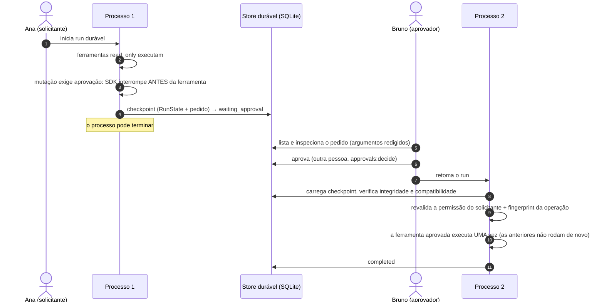

# Aprovação humana e retomada

Um run durável **suspende antes** de uma operação sensível, persiste seu estado, sobrevive ao fim do
processo, recebe a decisão de uma pessoa autorizada e **continua o mesmo run**, sem repetir o que já
fez. O mecanismo usa o `RunState` nativo do OpenAI Agents SDK; o starter acrescenta persistência,
integridade, identidade, compatibilidade e auditoria.

## Vocabulário

| Conceito | Neste projeto |
|---|---|
| **Pedido de aprovação** | uma operação concreta (nome, argumentos, risco), identificada por *fingerprint* e com prazo |
| **Interrupção** | o SDK parou o loop antes de uma ferramenta declarada com `needs_approval` |
| **Suspensão** | status `waiting_approval`: o run espera, persistido; nenhum processo o segura |
| **Checkpoint** | estado do SDK (sensível) + registro do run, em SQLite, com hash SHA-256 verificado |
| **Retomada** | o *mesmo* run continua: mesmo `run_id`, identidade, orçamento e manifesto |
| **Rejeição** | a operação não executa; o agente é informado e pode seguir sem ela |
| **Expiração** | a janela `HITL_APPROVAL_TTL_SECONDS` terminou: status `expired` |

## Fluxo entre processos



Pela CLI:

```bash
uv run agent-app run "..." --durable                  # suspende e termina o processo
uv run agent-app approvals list                       # pedidos do seu tenant
uv run agent-app approvals show <approval_id>         # o que exatamente seria autorizado
uv run agent-app approvals approve <approval_id> --reason "verifiquei o script"
uv run agent-app runs resume <run_id>                 # mesmo run, outro processo
uv run agent-app runs show <run_id>                   # status, pedidos e transições
```

Pela API, o mesmo ciclo usa `POST /api/v1/runs`, `GET /api/v1/approvals/{id}`,
`POST /api/v1/approvals/{id}/approve` e `POST /api/v1/runs/{id}/resume`
([referência](../reference/http-api.md)). **Aprovar não retoma**: depois de decidir todos os
pedidos, chame `resume`.

## Garantias

| Situação | Comportamento |
|---|---|
| Ferramenta executada antes da suspensão | nunca executa de novo (faz parte do estado do SDK) |
| Ferramenta aprovada | executa uma vez, por toda a política da fronteira de ferramentas |
| Argumentos mudaram depois da aprovação | `action_changed`: nada executa |
| Duas retomadas simultâneas | uma vence (compare-and-set no store); a outra recebe `resume_in_progress` |
| Decisão duplicada | `already_decided` |
| Permissão revogada durante a espera | a ferramenta aprovada é negada na retomada |
| Agente, modelo, configuração, perímetro de execução ou build mudou | `checkpoint_incompatible`: o run continua suspenso |
| Checkpoint adulterado ou corrompido | `checkpoint_corrupted` (SHA-256 verificado) |
| Operação não autorizada, ou com segredo nos argumentos | recusada antes de chegar a uma pessoa |

!!! note "Sem exactly-once para efeitos externos"
    O starter garante que a aplicação não repete uma operação. Não garante que um serviço externo
    não a tenha aplicado duas vezes por conta própria: isso exige uma chave de idempotência aceita
    pelo serviço.

## Quem pode o quê

| Ação | Permissão |
|---|---|
| listar, ver, aprovar ou rejeitar pedidos | `approvals:decide` (no tenant do operador) |
| retomar ou cancelar um run | `runs:resume` |
| ver um run e seus eventos | `runs:read` |
| iniciar um run pela API | `runs:start` |
| recuperar um run órfão (dono morto) | `runs:recover` |
| executar a ferramenta aprovada | a permissão **do solicitante**, revalidada na retomada |

**Separação de funções.** `approvals:decide` é necessária, mas não suficiente:

- o solicitante não aprova a própria operação (`self_approval`);
- um principal `service` não decide no lugar de uma pessoa (`approver_not_human`);
- quem aprova nunca passa a ser a identidade com que a ferramenta executa.

Há uma exceção, para desenvolvimento local: um `local_developer` com `HITL_SELF_APPROVAL=local`, o
padrão. `HITL_SELF_APPROVAL=never` remove a exceção. Outros tenants recebem `not_found`.

## Lease de execução entre processos

O processo que executa um run durável mantém um **lease**, renovado por heartbeat a cada um terço
de `HITL_LEASE_SECONDS` (padrão 30 s):

- outro processo não pode declarar o run parado enquanto o lease vive
  (`executing_elsewhere`, HTTP 409);
- expirado o lease, um operador com `runs:recover` encerra o run como `ambiguous`, porque seus efeitos
  são desconhecidos;
- o dono antigo, se ainda estiver vivo, perde o direito de escrever o resultado (*fencing*) e pede o
  próprio cancelamento.

O lease supõe um host e um relógio coerentes. Um dono parado (sem CPU) além do lease é
indistinguível de um dono morto. O resultado é `ambiguous` com fencing, nunca um efeito duplicado
pela aplicação.

## Workflows duráveis

`agent-app workflow incident INC-1042 --durable` suspende **antes do nó `act`** e retoma nele; os nós
anteriores não rodam de novo. Ferramentas de agentes *dentro* de um workflow que exigiriam uma pessoa
são **negadas**, em vez de suspensas: um nó não pode ser suspenso no meio do agente sem repeti-lo.

## Limitações

- Um host: o store é SQLite. Multi-host exigiria um store sobre PostgreSQL implementando o mesmo
  protocolo.
- Checkpoint sem criptografia em repouso (arquivo com permissão `0600` em POSIX). Trate o
  diretório de dados como sensível.
- Ferramentas MCP e agentes aninhados em workflows não suspendem: negam.
- Mudar o código bloqueia retomadas (`checkpoint_incompatible`): drene ou cancele os runs suspensos
  antes de um deploy.
