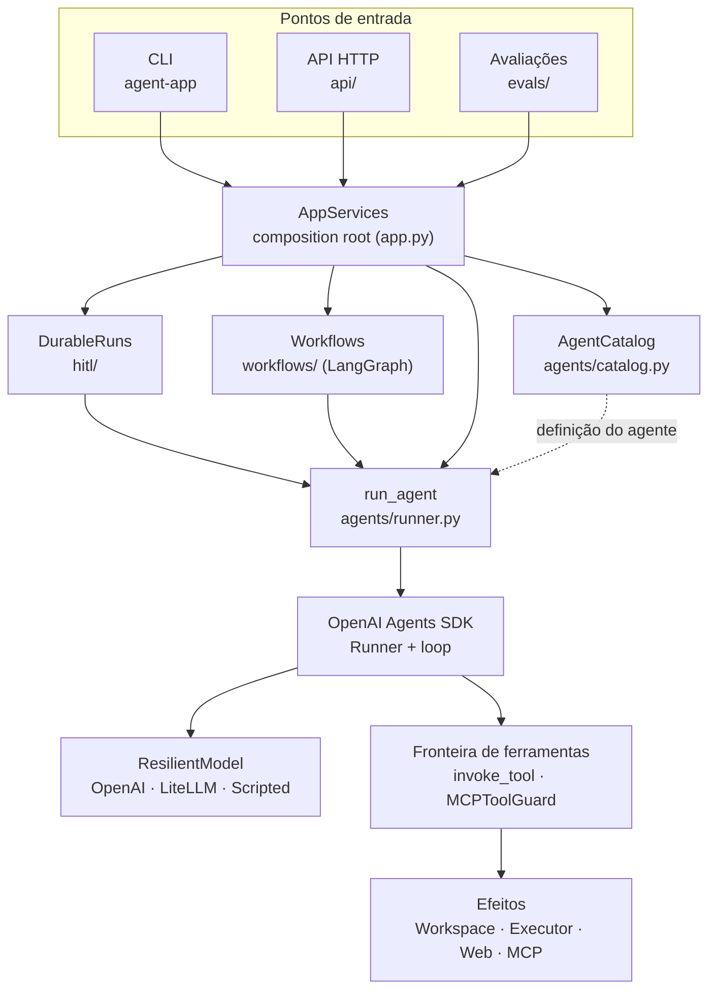

# Componentes

Esta página descreve as peças do runtime e a responsabilidade de cada uma. O código está em
`src/agent_app/`; os caminhos citados são relativos a esse diretório.

## Visão de componentes

Tudo que um run usa, como identidade, orçamento, política de aprovação, ledger de operações e
manifesto, viaja num único objeto, o `ToolRuntime`. Ele é passado como *run context* nativo do SDK e
fica disponível a cada ferramenta e guardrail. Os componentes transversais aparecem na
[seção abaixo](#componentes-transversais).

## Composição

### `AppServices`: composition root

`app.py`. É o único lugar que lê a configuração (`Settings`) e transforma configuração em objetos:
registro de ferramentas, catálogo de agentes, store de checkpoints, auditoria, executor, acesso web,
servidores MCP. CLI, API e avaliações recebem um `AppServices`; nada mais tem estado global.

- `tool_runtime(security=..., budget=..., policy=..., approver=...)` monta o `ToolRuntime` de um run.
- `run_agent(agent_id, prompt, runtime)` executa um agente do catálogo uma vez.
- `local_security_context(run_id)` cria a identidade de um run local (a partir de `IDENTITY_*`).

### `AgentCatalog` e definições de agente

`agents/catalog.py`. O catálogo registra **`CatalogAgent`s**. Cada entrada traz:

| Campo | Significado |
|---|---|
| `definition` | `AgentDefinition`: id, versão e instruções versionadas (`PromptTemplate` com `pinned_hash`) |
| `build` | função `(registry, mcp_servers) -> Agent[ToolRuntime]`: o agente do SDK, montado só com as ferramentas permitidas |
| `output_type` | contrato de saída (modelo Pydantic) |
| `required_features` | o que um modelo precisa oferecer (`tool_calling`, `structured_output`); fallbacks sem isso são recusados |
| `offline_model` | modelo roteirizado para testes e CI |
| `durable` | se o agente pode rodar como execução durável (e, portanto, pela API) |
| `tools` | ferramentas próprias, adicionadas ao registro do app |

Registrado, o agente é resolvido pelo id em todos os pontos de entrada, sem nenhuma mudança neles.
Veja [Construindo seu primeiro agente](../guides/first-agent.md).

## Execução do agente

### OpenAI Agents SDK

O starter **não** implementa um loop de agente. O `Runner` do SDK executa o loop (modelo → chamadas
de ferramenta → modelo …), valida a saída estruturada, aplica os guardrails nativos e produz os
spans de tracing. Isso também vale para a aprovação humana: o SDK interrompe o loop antes de uma
ferramenta com `needs_approval`, e o starter persiste o `RunState` nativo.

### `run_agent`: runner e runtime

`agents/runner.py`. Envolve uma chamada ao `Runner` com o que o SDK não decide: o modelo e a política
de chamada do run, o *run context* (`ToolRuntime`), o limite de turnos restante do orçamento, o
tracing sem conteúdo sensível por padrão, a telemetria e o resultado tipado (`AgentRunOutcome`).

### Adaptadores de modelo e resiliência

`agents/models.py` resolve o modelo configurado: OpenAI (inclusive gateways compatíveis via
`OPENAI_BASE_URL`), LiteLLM (outros provedores) ou o modelo roteirizado (offline).

`agents/resilience.py` (`ResilientModel`) é a **única** camada de retry. Ela repete só a chamada ao
modelo, com backoff e jitter, para erros transitórios classificados (429, 5xx, conexão, timeout), e
pode trocar para modelos de fallback que declarem as features exigidas. Os retries do próprio SDK e
do cliente OpenAI ficam desligados. Uma tentativa ambígua (timeout, 500/502/504) tem consumo
**desconhecido**, nunca zero.

### Workflows

`workflows/`. Processos com estado em LangGraph, que combinam nós determinísticos com nós que chamam
agentes. O workflow de exemplo é `incident`:
`load_incident → investigate → classify → act → verify → record_outcome`. Toda mutação de um nó é
registrada no ledger de operações, e um workflow durável suspende antes do nó `act`.

## Ferramentas e efeitos

### Registro de ferramentas

`tools/registry.py`. Cada ferramenta é um `ToolSpec` com três classificações independentes:

| Classificação | Pergunta | Exemplo |
|---|---|---|
| **Capability** | que agente pode receber esta ferramenta? | `fs.read`, `search`, `exec`, `fs.write`, `web.fetch` |
| **Risk** (`OperationRisk`) | uma pessoa precisa confirmar? | `read_only`, `local_mutation`, `external_mutation`, `production_mutation`, `destructive` |
| **Permission** | este principal pode fazer isso? | `workspace:read`, `checks:execute`, `mcp:<servidor>` |

Um agente recebe o mínimo: `registry.select(capabilities=..., max_risk=...)`.

Ferramentas embutidas:

| Ferramenta | Capability | Risco |
|---|---|---|
| `list_directory`, `read_file`, `file_metadata` | `fs.read` | `read_only` |
| `find_files`, `search_text` | `search` | `read_only` |
| `run_check` | `exec` | `local_mutation` |
| `write_file` | `fs.write` | `local_mutation` |
| `web_search`, `web_fetch` | `web.search`, `web.fetch` (opt-in) | `read_only` |

### A fronteira de ferramentas: `invoke_tool` e `MCPToolGuard`

`tools/sdk.py` e `tools/guard.py`. **Toda** chamada de ferramenta local passa por `invoke_tool`, e
toda chamada MCP passa pelo `MCPToolGuard`, nas mesmas etapas e na mesma ordem: orçamento →
autorização → política de argumentos → aprovação → execução registrada no ledger → saída sanitizada
e marcada como não confiável → auditoria. Detalhes em
[Ciclo de vida](execution-lifecycle.md#7-invocacao-de-ferramentas).

### `OperationLedger`

`execution/operations.py`. Toda chamada de ferramenta é uma **operação** do run, com dono, risco e
desfecho. O ledger:

- serializa as mutações do run (uma por vez; nenhuma começa enquanto outra está indefinida);
- distingue `interrupted` (parou sem efeito) de `unsettled` (pode ainda estar rodando);
- registra `effect` (`none`/`unknown`) e `retry_safe`;
- alimenta a regra única de fim de run: se uma mutação pode ter tido efeito não confirmado, o run
  termina `ambiguous`.

Trabalho bloqueante de uma ferramenta roda em `operations.run_sync(...)`, para que o ledger saiba
se uma thread ainda executa.

### Workspace e executores

- **`Workspace`** (`execution/workspace.py`): o único diretório que as ferramentas de arquivo podem
  tocar. Toda entrada passa por uma política sintática portável (a mesma no Windows e no Linux) e
  depois pela verificação de contenção do caminho **resolvido** (symlinks seguidos). Nomes sensíveis
  (`.env`, chaves, credenciais) são recusados. Escrita é desligada por padrão.
- **Executores** (`execution/subprocess.py`): comandos só por alias de uma allowlist, sem shell, com
  timeout, limite de saída e ambiente reconstruído. A árvore de processos de cada comando pertence
  ao run: Job Object no Windows, grupo de processos no POSIX. O `DockerExecutor`
  (`execution/sandbox.py`) roda o comando num contêiner descartável, com sistema de arquivos somente
  leitura e rede configurável. Ele reduz o impacto, mas não é um sandbox completo.

### MCP

`mcp/` e `tools/mcp.py`. Servidores MCP são declarados em `mcp_servers.json`, com `allowed_tools`,
nível de risco e ambiente explícito. As tools MCP passam pela mesma política das locais. O starter
inclui um servidor de exemplo (`incident-knowledge`, runbooks somente leitura).

### Web Search e Web Fetch

`web/`. Capacidades **opt-in**: busca devolve pistas do provedor; fetch lê uma URL pública sob
política de rede (esquemas, portas, nomes locais, endereços não públicos), conectando ao endereço já
validado e revalidando redirects. Conteúdo web é sempre dado não confiável. Nos testes, uma internet
sintética substitui a rede.

## Componentes transversais

### Identidade e autorização

`contracts/identity.py`, `security/authorization.py`. Cada run tem um `SecurityContext` imutável:
tenant, principal (e *como* foi estabelecido), identidade técnica do agente, permissões. Ele vem só de
código confiável: a configuração na CLI, a chave verificada na API ou o caso de avaliação. Nunca vem
do modelo ou dos argumentos de uma ferramenta. Permissões são *deny by default* e exatas
(`workspace:write` não implica `workspace:read`).

### Guardrails

`security/guardrails.py`, `tools/guard.py`. Quatro fronteiras: entrada, argumentos de ferramenta,
saída de ferramenta e saída final. Os controles obrigatórios são determinísticos e *fail-closed*;
heurísticas de prompt injection são um alarme, não uma defesa. Veja [Segurança](../security.md).

### HITL e `DurableRuns`

`hitl/`. Execuções duráveis: suspensão antes de operações que exigem uma pessoa, checkpoint do
`RunState` do SDK com verificação de integridade, decisão por outro principal, retomada do mesmo
run. Também mantém um **lease** de execução entre processos. Veja
[Aprovação humana e retomada](hitl.md).

### Budgets

`contracts/budget.py`, `execution/budget.py`. Cada run tem um `ExecutionBudget` (turnos, tokens,
custo estimado, duração, chamadas de ferramenta, timeout por ferramenta) definido por código
confiável, nunca pelo modelo nem pelo corpo de uma requisição. Esgotado um limite obrigatório,
nenhuma operação nova começa e o run termina `limit_exceeded`. Custo desconhecido não conta como
zero.

### `ExecutionManifest`

`contracts/versioning.py`, `agents/identity.py`. Fixado no início de cada run e nunca reescrito.
Registra versões e hashes de instruções, ferramentas (descrição e schema), servidores MCP,
guardrails, contrato de saída, modelo e fallbacks, uma *allowlist* tipada da configuração
(orçamento, resiliência, aprovações, perímetro de execução) e a identidade do build. Serve para
comparar runs (`agent-app runs diff`) e para recusar a retomada de um checkpoint cujo agente,
configuração ou build mudou.

### API HTTP e SSE

`api/`. Adaptador FastAPI sobre os mesmos runs duráveis da CLI. Autentica por chave de API, projeta
contratos públicos versionados (`/api/v1`), publica eventos de ciclo de vida via SSE a partir de uma
allowlist de campos e nunca transmite argumentos, resultados ou texto do modelo. Desconectar o SSE
não cancela o run. Veja a [referência da API](../reference/http-api.md).

### Observabilidade

`observability/`. Logs estruturados (structlog), tracing nativo do SDK (para log, para a OpenAI ou
desligado), trilha de auditoria (`audit.jsonl`) e log de runs (`runs.jsonl`) com o manifesto.
Habilitar tracing e capturar conteúdo são decisões separadas: por padrão, nenhum prompt, saída do
modelo ou argumento de ferramenta é capturado.

### Avaliações

`evals/`. Datasets versionados e travados por hash, adaptador que executa cada caso no runtime real,
avaliadores determinísticos por dimensão (sucesso, uso de ferramentas, segurança, confiabilidade,
eficiência), relatórios sem conteúdo, comparação com baseline, gates, revisão humana e juiz LLM
opcional. Veja [Testes e avaliação](../guides/testing-and-evaluation.md).

## Contexto, estado, sessão e memória

Quatro conceitos com ciclos de vida diferentes, mantidos separados:

| Conceito | O que é | Onde |
|---|---|---|
| **Context** | o que o modelo vê nesta chamada, montado e limitado pela aplicação | `context/builder.py` |
| **State** | o estado de um workflow em execução | `workflows/*/state.py` |
| **Session** | continuidade entre runs (mecanismo do SDK, SQLite) | `sessions/` |
| **Memory** | conhecimento persistido com proveniência, que só o software decide gravar | `memory/` |

O histórico de uma sessão volta ao modelo sob uma política da aplicação (`context/history.py`).
