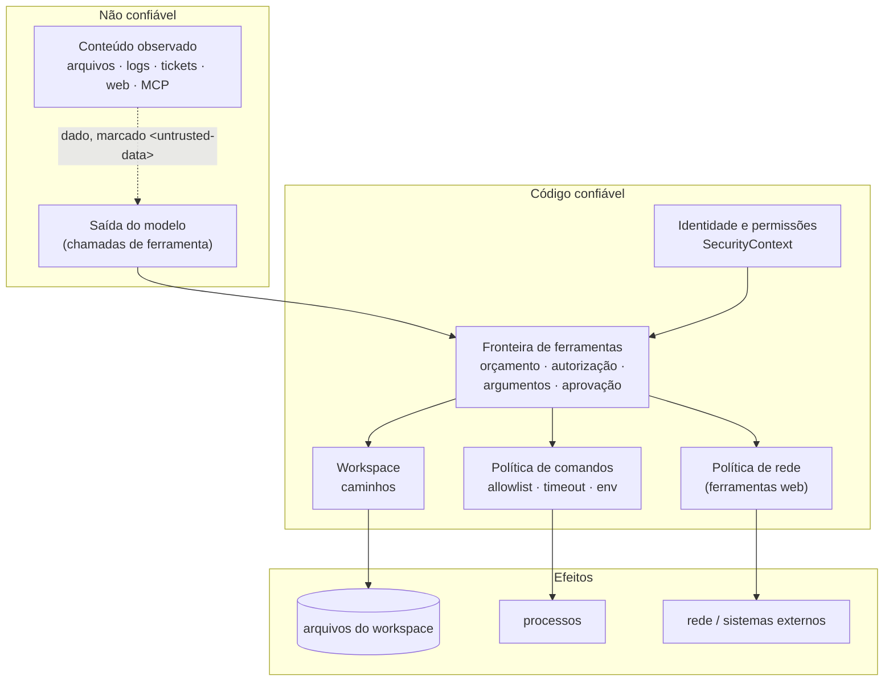

# Segurança e limitações

O modelo de segurança parte de uma regra: **o modelo pede; o código decide e executa.** Instruções
orientam o agente, mas nenhuma garantia depende de o modelo obedecê-las. As garantias vêm de
identidade, permissões, fronteiras de execução determinísticas, aprovação humana e registro.

Esta página descreve o que é garantido e como, e também o que **não** é.

## Fronteiras de confiança

- A identidade entra só por código confiável (configuração, chave verificada, caso de avaliação).
- Tudo que o modelo pede atravessa a fronteira de ferramentas.
- Tudo que volta do mundo é **dado**, nunca instrução, e chega ao modelo marcado como não confiável.

## Garantias implementadas

### Identidade e permissões

- Cada run tem um `SecurityContext` **imutável**: tenant, principal (e como foi estabelecido),
  identidade técnica do agente, permissões e `run_id`.
- Permissões são *deny by default*, explícitas e exatas. Não há curingas, e `workspace:write` não
  implica `workspace:read`.
- O modelo nunca fornece identidade: nenhuma ferramenta tem parâmetro de tenant, principal ou
  permissões, e argumentos extras são descartados.
- Dados persistidos por tenant exigem tenant explícito. Pela API, um recurso de outro tenant
  responde `404`.
- Na CLI, a identidade é **afirmada por configuração** (`local_developer`), não autenticada. Na API,
  vem de uma chave verificada.

### Políticas de ferramentas

Toda ferramenta declara **capability** (que agente pode recebê-la), **risco** (precisa de uma
pessoa?) e, por consequência, **permissão** (este principal pode?). A ordem de verificação é fixa e
igual para ferramentas locais e MCP: **orçamento → autorização → argumentos → aprovação → efeito**.
Uma recusa volta ao modelo como dado (`denied_by_execution_environment`) e é auditada.

| Risco | Exemplo | Política padrão |
|---|---|---|
| `read_only` | ler e buscar no workspace | permitido |
| `local_mutation` | escrever no workspace, rodar um script de verificação | exige aprovação |
| `external_mutation` | abrir um ticket, chamar uma API externa | exige aprovação |
| `production_mutation` | alterar um sistema de produção | exige aprovação |
| `destructive` | apagar, sobrescrever sem backup | **negado**, mesmo com aprovação |

### Guardrails

| Fronteira | Controle |
|---|---|
| Entrada | alarme de prompt injection (bloqueia a entrada do usuário) |
| Argumentos de ferramenta | schema estrito, política de caminhos e comandos, segredos em argumentos |
| Saída de ferramenta | redação de segredos, sinalização de injeção suspeita, truncamento, marcação de não confiável, retenção de conteúdo MCP não textual |
| Saída final | bloqueio de segredos em formatos conhecidos e de valores sensíveis conhecidos pela aplicação |

Os controles obrigatórios são **determinísticos e fail-closed**. Nenhum depende de uma decisão
probabilística, e não há guardrail baseado em LLM. A detecção de prompt injection é heurística: um
**alarme**, não uma defesa. A defesa é menor privilégio, autoridade de execução e aprovação.

### Aprovação humana

- Operações acima de `read_only` passam pela porta de aprovação, que **reverifica a permissão** antes
  de perguntar a alguém. Aprovar não substitui permissão.
- Uma decisão vale para **uma** operação concreta (*fingerprint* dos argumentos). Argumentos
  alterados invalidam a aprovação.
- Separação de funções: o solicitante não aprova a própria operação, e um serviço não aprova no
  lugar de uma pessoa (veja a exceção para desenvolvimento local em
  [Aprovação humana e retomada](architecture/hitl.md#quem-pode-o-que)).
- Operações não autorizadas, ou com segredos nos argumentos, nunca chegam a um aprovador.

### Controle de mutações

- Toda chamada de ferramenta é uma operação do `OperationLedger`. Mutações de um run são
  **serializadas**, e nenhuma começa enquanto outra pode estar executando.
- O cancelamento só interrompe o que não tem efeito. Uma mutação em voo termina.
- Ferramentas nunca são repetidas automaticamente pela aplicação. Retry existe só para a chamada ao
  modelo.
- Um run com efeito de mutação não confirmado termina `ambiguous`, nunca `completed` ou `cancelled`.

### Manifestos e retomada

- Cada run tem um `ExecutionManifest` imutável: versões e hashes de instruções, ferramentas,
  contratos, modelo, configuração relevante, perímetro de execução e build. Ele não guarda conteúdo
  de prompt, segredos, URLs nem cabeçalhos.
- Um checkpoint só é retomado se for **íntegro** (SHA-256) e **compatível** (mesmo agente,
  configuração, perímetro e build). Do contrário, o run fica suspenso com um código explícito.

### Conteúdo não confiável

Arquivos, logs, tickets, páginas web e saídas de ferramentas e MCP são **dados**. Eles chegam ao
modelo envoltos em `<untrusted-data>`, com segredos redigidos e suspeitas de injeção sinalizadas. As
instruções dos agentes reforçam essa regra, mas a segurança não depende delas: o que um conteúdo
malicioso consegue pedir continua limitado pelas permissões e pela fronteira de execução.

### Conteúdo web

Web Search e Web Fetch são **opt-in** por capability. Um agente só as recebe se pedi-las
explicitamente. A política de rede valida esquema, porta, nomes e endereços, recusando destinos não
públicos. A conexão é feita no endereço já validado (não há segunda resolução de nome), redirects
são revalidados e não há uso de proxy do ambiente. Não dê ferramentas web a um agente que também lê
dados internos sem uma política de domínios.

### Workspace

- As ferramentas de arquivo só tocam o diretório `WORKSPACE_ROOT`.
- Cada caminho recebido passa por uma **política sintática portável**, idêntica no Windows e no
  Linux. Ela recusa caminhos absolutos em qualquer sintaxe, formas de drive, UNC e device, traversal
  acima da raiz com `/` ou `\`, *alternate data streams*, nomes reservados do Windows e componentes
  ambíguos.
- Depois vem a verificação de **contenção do caminho resolvido**, seguindo symlinks. Por fim, a
  recusa de nomes sensíveis (`.env`, chaves, credenciais, diretórios de configuração de ferramentas).
- Escrita desligada por padrão (`ALLOW_WRITES=false`), com limite de tamanho.

!!! note "Restrição deliberada da interface"
    `\` é tratado como separador em todas as plataformas, para que um caminho signifique a mesma
    coisa no Windows e no Linux. Por isso, um nome de arquivo com barra invertida literal (válido no
    Linux) não é endereçável pelas ferramentas.

### Subprocessos

- Comandos só por **alias de uma allowlist**, sem shell, com timeout, limite de saída e ambiente
  reconstruído (segredos do processo pai não são herdados). O interpretador Python só executa
  scripts `.py` do workspace.
- **Windows:** cada comando é criado suspenso e associado a um **Job Object** antes de executar
  qualquer código; todo processo que ele cria pertence ao job desde a criação. O fim da árvore é
  confirmado pela contagem do próprio sistema operacional. Se a contenção não puder ser
  estabelecida, o comando não executa.
- **POSIX:** cada comando roda em sua própria sessão (grupo de processos), encerrada com `killpg`.
- Uma limpeza que não pode ser confirmada é **reportada** (`unsettled`, `ambiguous`), nunca
  declarada concluída.

### Limites de recursos

Orçamento por run (turnos, tokens, custo estimado, duração, chamadas de ferramenta, timeout por
ferramenta), definido por código confiável. Pela API, os limites são do servidor, nunca do corpo da
requisição. Há também limites de concorrência, de taxa de requisições e de tamanho de corpo por
processo. Custo desconhecido não conta como zero.

### Auditoria

Chamadas de ferramenta, recusas, aprovações e decisões, eventos de HITL, paradas por orçamento,
recuperação de chamadas ao modelo, operações interrompidas ou indefinidas e manifestos vão para a
trilha de auditoria. O registro guarda **nomes** de achados (por exemplo, "segredo redigido"),
nunca valores. Logs e spans não capturam conteúdo por padrão; segredos em formatos conhecidos são
sempre redigidos dos logs da aplicação.

## Limitações

!!! danger "O starter não é um sandbox"
    As garantias acima são **lógicas**: impedem que o *modelo* faça o que a política não permite
    por meio das ferramentas. Elas não isolam um *processo* de forma forte.

- **Sem sandbox forte e universal.** O executor local roda comandos com a autoridade do usuário do
  sistema operacional: acesso de rede e a arquivos fora do workspace continua possível para o código
  executado. O executor Docker reduz o impacto, mas não é um isolamento completo.
- **Job Objects não são isolamento de segurança.** Eles garantem a *posse* e o *encerramento* da
  árvore de processos no Windows, não restringem o que os processos fazem. Processos criados fora da
  árvore, por meio de serviços, tarefas agendadas, WMI, COM/DCOM ou do daemon do Docker, não são
  contidos.
- **Restrições lógicas não substituem permissões do sistema operacional.** Rode o processo com um
  usuário de privilégio mínimo e proteja `DATA_DIR`: ele contém checkpoints (com o estado dos runs),
  auditoria e histórico.
- **Limitações POSIX conhecidas.** Um descendente que cria a própria sessão (`setsid`) escapa do
  encerramento do grupo; descendentes que se desligam dos pipes não são detectados após um término
  normal; a morte do processo Python não encerra o grupo.
- **Rede sem restrição para comandos.** A política de rede vale para as ferramentas web, não para
  scripts executados por `run_check`.
- **Corridas entre verificação e uso** (TOCTOU) de caminhos não são eliminadas pela política do
  workspace.
- **Identidade local não é autenticação.** Na CLI, `IDENTITY_*` é afirmado por configuração.
- **Detecção de injeção é heurística** e pode ser contornada; ela sinaliza, não protege.
- **Auditoria** síncrona, em arquivo local, sem garantia contra adulteração (*not tamper-evident*).
- **Isolamento entre tenants** existe nos dados do runtime durável e da API. Workspace, trilha de
  auditoria e processos MCP não são segregados por tenant.
- **Leash é uma proposta futura**, não uma capacidade implementada. Veja
  [Próximos passos](roadmap.md).

## Para executar código não confiável

Não use o executor local. Até que exista uma fronteira forte, código não confiável exige isolamento
externo ao starter: contêineres com perfis restritivos, gVisor ou microVMs, rede negada por padrão e
credenciais ausentes do ambiente. Veja [Operação e implantação](operations.md).

## Relatando vulnerabilidades

Não abra issues públicas para vulnerabilidades. Contate os mantenedores do repositório por um canal
privado (por exemplo, os *Security Advisories* do repositório), com os passos de reprodução.
